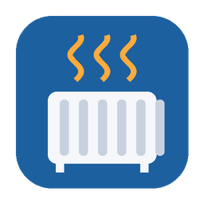

# ioBroker.mill-local – Kurzbeschreibung auf Deutsch

Die vollständige Dokumentation steht in der englischen [README](README.md).

Der Adapter bindet Mill-Geräte der **Generation 3** (Panel-, Konvektions- und Ölheizungen sowie die
WLAN-Steckdose) über ihre **lokale API** ein – ohne Cloud, Konto oder App. Mehrere Geräte je Instanz,
Geräteart wird automatisch erkannt, Netzwerksuche und Wiederfinden nach Adresswechsel über die MAC-Adresse.

- **Jeden Wert gibt es nur einmal.** `control.*` (Solltemperatur, Betriebsart, Ein/Aus) und `settings.*` (alle
  Einstellungen, die die API ändern kann) zeigen den Gerätewert und sind direkt beschreibbar.
- **Steuerung ist ab Werk ein**; ausgeschaltet sind `control.*` und `settings.*` nur lesbar.
- **EIN schaltet immer ein** – manueller Modus `Switch`, Relais an, unabhängig von Thermostat, Wochenprogramm
  und Sollwert. **AUS schaltet immer aus** (in `Switch` öffnet das Relais, sonst Betriebsart `Off`). Für Heizen
  nach Thermostat eine Betriebsart wie `Control individually` wählen.
- **Uhrzeit:** Das Gerät holt sie nur per NTP von `pool.ntp.org` – und nur, wenn vorher ein Ping an `4.2.2.1`
  beantwortet wird (fest eingebaut; ohne Gateway nimmt es x.x.x.1 an). Rein lokal: Gateway per DHCP, Firewall
  erlaubt nur ICMP vom Gerät an `4.2.2.1`, `pool.ntp.org` per DNS auf einen lokalen NTP-Server lenken. Die
  Zeitzone setzt der Adapter aus ioBroker. Wochenprogramm, Einzeltimer und Urlaub
  sind als JSON les- und schreibbar.
- **Falle:** Das Gerät quittiert jede Betriebsart mit „ok“ und schaltet sich bei unbekannten Werten AUS – der
  Adapter sendet deshalb nur die dokumentierten Betriebsarten.
- **Ohne Internet:** Lokale API und Betriebsart „Control individually“ laufen ohne Internet; Wochenprogramm
  und Timer brauchen die Uhrzeit, die das Gerät nur aus dem Internet holt.
- Die Energiewerte sind geschätzt (Leistung × Zeit zwischen zwei Abfragen).
- **Unterschied zu `millheater`:** Jener Adapter nutzt ebenfalls die lokale API, aber ein Gerät je Instanz (Öl-
  und Panelheizungen, Soll/Betriebsart/Leistungsstufe). `mill-local` kann mehrere Geräte je Instanz samt Suche,
  alle Gen-3-Geräte einschließlich WLAN-Steckdose und alle über die API änderbaren Einstellungen.
